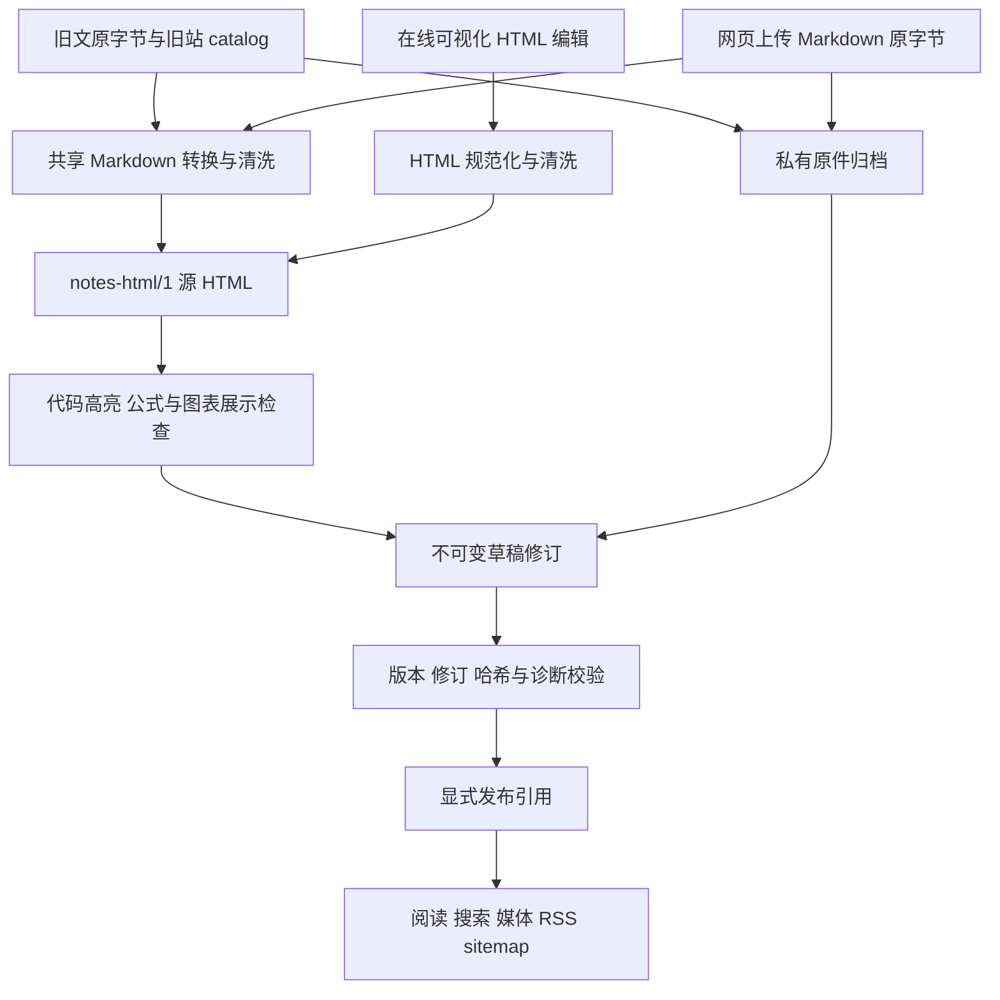

# 当前开发实现汇总

更新：2026-09-27。HTML 笔记应用已具备上传、可视化编辑、版本化发布、阅读、媒体、检索及隔离迁移能力。第 7 批原始迁移库保存 253 篇 HTML 草稿，其中初始 251 篇通过检查，随后在新的隔离库为剩余 2 篇各建一个修订，当前 253 篇均通过源与展示检查。原修订库仍为 0 篇公开；第 8 批独立预发布副本发布 253 篇后部署到 UCloud。原始 Markdown 未改，MVP 数据库的 1 篇笔记另行迁移为 2 个修订。当前 `sunjiao.me` 已通过 UCloud Nginx TCP 443 公开提供该动态站，证书自动续期模拟通过；作者侧真实内容/写作浏览器验收仍待回报。[内容续记](./BATCH-07-CONTENT-READING-ACCEPTANCE.md)记录迁移修订与抽样检查，[b9 部署状态](./B9-DEPLOYMENT-STATUS.md)记录正式切换。

用户随后明确授权浏览器连接器访问本机 4315，第 5/6 批在隔离合成实例完成浏览器验收，第 7 批在恢复副本抽样阅读 5 篇迁移文章。第 8 批完成旧 URL、备份恢复与 UCloud 部署；b9 补齐旧导航并在公网返回预期状态码。本机离机备份按清单校验 254/254。逐篇全文审校、生产浏览器试用、客户端 VPN/订阅/NewAPI 功能确认，以及持续告警与备份自动化尚未完成。

## 架构与运行模式

应用源码位于 `technical-notes-lab`，与原 Astro 项目分开。Node.js 24 HTTP 服务连接免费 SQLite，正文存数据库，原件及媒体放在私有受管理目录。没有数据库订阅费；部署服务器、域名和存储另行安排。

| 部分 | 当前实现 |
| --- | --- |
| 默认 Markdown MVP | 不设 HTML_EDITOR 时保留旧数据库与 `/write` 写作台；原 Markdown API 和导入脚本仍可用 |
| 显式 HTML 模式 | `HTML_EDITOR=1` 且指定隔离 DATA_DIR；`/admin/html` 编辑，`/` 与 `/notes/:id` 读取 HTML 发布快照；拒绝写入受保护的默认 data |
| 正文修订 | `html_source` 是唯一可编辑正文；同一不可变修订保存 `html_rendered`、元信息、目录、诊断和版本信息 |
| 草稿与公开状态 | `html_notes` 独立引用 draft_revision_id 和 published_revision_id；所有匿名正文、媒体、搜索、RSS 和 sitemap 仅使用当前发布引用 |
| 原件与媒体 | 原字节 SHA-256 归档；媒体内容寻址及修订引用授权；SQLite、原件和媒体联合备份恢复 |
| 派生检索 | 源 HTML AST 提取纯文本存入 revision_search；提取器版本升级仅重建派生索引，不改源修订或发布引用 |

核心实现分别位于 `lib/html-content.mjs`、`html-core.mjs`、`html-render.mjs`、`html-store.mjs`、`html-media.mjs`、`html-discovery.mjs`、`html-backup.mjs` 和 `html-batch-migration.mjs`。服务路由在 `server.mjs`，编辑模型与交互在 `public/html-schema.js`、`html-editor.js`，阅读工具在 public 目录。

## 三类内容入口与发布流程

1. **旧文迁移**：先核对原件与既有旧站 catalog，预分配文章 ID、旧 URL、标题锚点和资源映射，再按原字节转换及归档。文章只建立草稿，不因来源 `draft:false` 自动发布。MVP SQLite 草稿与旧发布快照使用独立入口分别转换。
2. **网页上传**：上传原始文件字节，经严格 UTF-8、frontmatter、Markdown/嵌入 HTML 清洗进入同一转换器。相同来源与哈希返回已有文章；变化来源不能覆盖已被作者编辑的稿件。
3. **在线写作**：ProseMirror 可视化编辑规范 HTML，保存时重新规范化并生成展示产物，不反向生成 Markdown。代码、LaTeX、Mermaid 源码与标题 ID 保留，无法无损加载时阻止破坏性保存。
4. **公开阅读**：发布核对文章版本、指定修订、源哈希、源/展示状态和阻断诊断；发布与撤回均递增 CAS 版本。有效源即使展示失败也可存草稿，但不能替换旧发布快照。阅读不调用 Markdown 转换器。

## 已实现能力

| 范围 | 已实现行为与边界 |
| --- | --- |
| 编辑 | 新建、原字节上传、自动/手动保存、重新打开、历史恢复为新草稿、两页冲突保护、本地 HTML 导出；复杂节点保留源码 |
| 正文 | 标题、列表、引用、任务项、表格、折叠、链接、图片、代码高亮、KaTeX 公式、Mermaid；危险/不支持结构明确清洗或诊断 |
| 发布 | 草稿/发布分离；源与展示同修订；公开 DTO 白名单；撤回立即退出公开列表、正文和派生输出 |
| 媒体 | PNG/JPEG/GIF/静态 WebP 与受限附件上传；真实格式和大小检查；缺图逐项补传、替换生成 CAS 新草稿；附件强制下载 |
| 分类与检索 | 同修订分类和标签，中文与技术符号字面检索；多词 AND；公开结果只查发布修订，当前无相关性排名或分页 |
| 阅读 | 目录、当前章节、阅读进度、代码复制、图表查看/缩放；第 5/6 批新增界面交互已在隔离实例浏览器补验 |
| 导出 | 私有规范源 HTML、私有归档原字节、公开展示 HTML 分离；公开导出无脚本，MathML 公式与 Mermaid 源码可读，图片仍依赖原站在线 |
| 迁移与恢复 | 两阶段旧文映射、来源归档、幂等、在线稿冲突保护、逐项诊断、独立 MVP 迁移、SQLite 在线备份、联合校验恢复 |

正文契约及限额见 [HTML-SOURCE-SPEC](./HTML-SOURCE-SPEC.md)。媒体格式校验不等同于杀毒或完整解码；外部 HTTPS 图片不由服务器抓取。搜索、转换和编辑测试均不构成生产负载承诺。

## 实际迁移结果与保存位置

下列运行路径均相对于 `technical-notes-lab`，位于被忽略的私有 `.test-data` 目录；报告放在 `doc/technical-notes-lab/batch-07`。

| 产物 | 当前路径 | 核验结果 |
| --- | --- | --- |
| 最终旧文 HTML 库 | `.test-data/batch-07-library-final` | 253 篇/253 修订，0 发布；251 ready/ready，2 篇人工检查 |
| 内容修订后的隔离库 | `.test-data/batch-07-content-reviewed` | 253 篇/255 修订，当前 253 篇 ready/ready、可发布，0 发布；原始迁移库保持历史证据 |
| 旧文备份与恢复库 | `.test-data/batch-07-library-final-backup`、`.test-data/batch-07-library-final-restored` | 联合恢复 integrity=ok；恢复库 HTTP 作者列表 253，匿名私有接口 401，未发布正文 404 |
| MVP 隔离迁移库 | `.test-data/batch-07-mvp` | 原库 1 篇另行迁移为 2 修订，保留独立草稿/发布与副本旧表 |
| MVP 备份与恢复库 | `.test-data/batch-07-mvp-backup`、`.test-data/batch-07-mvp-restored` | 联合恢复 integrity=ok；旧表字段与真实源一致 |

这些目录内部使用 `notes.sqlite`、`source-archives` 和 `media`。最终 catalog 为 [migration-catalog-final.json](./batch-07/migration-catalog-final.json)，逐项报告为 [migration-library-final.json](./batch-07/migration-library-final.json)。首轮 `.test-data/batch-07-library` 的 `legacy-*` ID 不兼容服务路由，已被上述纯 hex ID 最终库替代，不应继续使用。

253/253 原件字节、源哈希、元数据及旧 URL 已核验；253 次相同源重导均 unchanged，原始迁移库修订数仍为 253。506 条原件登记分别用于独立来源清单与修订引用，底层复用同一组 253 份原字节，不是 506 篇文章。真实源 AST 检出 0 个图片引用、19 个外链、0 个内部链接；19 处外链的 12 个不同地址于 2026-09-24 逐一只读打开。合成测试覆盖相对资源、缺图、跨文链接和旧锚点。

MVP 归档来自 SQLite 文本的 UTF-8 编码，不能当作最初上传文件的原字节。两类来源独立核算，不将 1 篇 MVP 笔记合并宣称为原始 253 篇之一。

## 批次与证据

| 批次 | 已验证结果 | 证据 |
| --- | --- | --- |
| 1 | 基线、253 原文保护、15 项黄金样例完整性 | [第 1 批报告](./BATCH-01-ACCEPTANCE.md) |
| 2 | 转换/清洗/展示与预检查；当批 24/24；10 篇旧文和专门样例浏览器检查 | [第 2 批报告](./BATCH-02-ACCEPTANCE.md) |
| 3/4 | 修订、归档、恢复与可视化写作；当批 64/64；编辑器真实浏览器往返通过 | [第 4 批报告](./BATCH-04-ACCEPTANCE.md)、[浏览器记录](./BATCH-04-BROWSER.md) |
| 5/6 | 发布、媒体、检索及阅读功能；当批 76/76、独立 HTTP 集成 4/4；随后隔离合成实例浏览器验收通过 | [第 6 批报告](./BATCH-06-ACCEPTANCE.md)、[浏览器记录](./BATCH-05-06-BROWSER.md) |
| 7 | 253 旧文与 1 篇 MVP 独立迁移恢复；迁移测试 5/5，修复模块回归 15/15；两篇内容修订、5 篇浏览器阅读抽样与 12 个外链地址检查完成 | [第 7 批报告](./BATCH-07-ACCEPTANCE.md)、[内容阅读续记](./BATCH-07-CONTENT-READING-ACCEPTANCE.md)、[独立对账](./batch-07/independent-migration-check.json)、[恢复 HTTP](./batch-07/restored-http-check.json) |
| 8 与 b9 切换 | 253 条旧 URL 与 4,410 锚点映射；第 8 批完整回归 83/83，b9 84/84；UCloud HTTPS/DNS 正式切换，证书模拟续期与离机副本清单通过；真实生产浏览器验收待办 | [第 8 批报告](./BATCH-08-ACCEPTANCE.md)、[b9 部署状态](./B9-DEPLOYMENT-STATUS.md) |

第 7 批主代理完整回归 **82/82 通过，0 失败/取消/跳过/todo，退出码 0，128808.3255 ms**，见 [测试输出](./batch-07/full-tests.txt)。当时 253 篇原文和 281 个原站受保护文件未改变；52 个代码/测试文件与 [源码清单](./batch-07/source-manifest.json)和[快照](./batch-07/source-snapshot.zip)一致。环境见 [environment.json](./batch-07/environment.json)，保护与快照复核见 [closeout-check.json](./batch-07/closeout-check.json)。第 8 批修改后另跑完整测试 **83/83 通过**。历史批次测试计数不能相加作为当前全套测试数量。

## 操作入口

- [HTML 写作台指南](./HTML-EDITOR-GUIDE.md)：隔离启动、编辑、发布与当前 API。
- [媒体与检索指南](./HTML-MEDIA-SEARCH-GUIDE.md)：上传、补图、分类、搜索、阅读和 feed。
- [旧文批迁移指南](./HTML-BATCH-MIGRATION-GUIDE.md)：catalog、全量草稿迁移、resume、冲突及验证。catalog 脚本依赖原 Astro 项目现存缓存、生成稿和根 `node_modules/devalue`；仅在应用目录执行 `npm ci` 不能重建旧 catalog。不要运行根 build/import 来代替本次只读流程。
- [数据与备份指南](./HTML-DATA-GUIDE.md)：独立 MVP 迁移、显式选库、原件/媒体联合备份及恢复。
- [转换预检查指南](./CONVERSION-GUIDE.md)：只生成 HTML/报告，不写文章数据库。

应用可用 `npm start` 启动，`npm test` 运行临时库测试。HTML 模式应显式指定 DATA_DIR、HTML_DB_PATH、HTML_ARCHIVE_DIR、HTML_MEDIA_DIR；迁移/恢复库的名称与新写作台默认 `html-notes.sqlite` 不同，不要凭目录猜测库文件。HTML 编辑器 bundle 的构建命令是应用内 `npm run build:editor`，与原 Astro 站点构建无关。

## 未完成与下一步

1. **生产内容与写作验收**：两篇诊断已修订，恢复副本浏览器抽样阅读 5 篇；公网 HTTP 导航、RSS/sitemap 与健康接口通过，但作者尚未确认真实文章、旧锚点、移动端布局、登录与写作流程。253 篇逐篇全文审校不由抽样代替；12 个外链地址此前可读，需按实际使用复查。
2. **运行保障**：systemd、HTTPS、证书 nginx HTTP-01 模拟续期与本机离机备份已做。cron 的下一次真实触发、长期自动离机复制/保留策略、故障告警、真实证书更新后的加载和故障恢复演练仍待做；现有 cron 仍执行 b8 中的备份脚本，应开发 b9 自身的生产备份入口。
3. **源码与后续开发**：当前本地应用与文档仍大量未跟踪，先审查忽略规则并纳入 Git，不提交数据库、原件、口令或备份。第 9 批集中处理生产试用发现的问题、备份/告警自动化与必要的性能测量。GitHub Pages 静态导出不再是本次动态站公开运行的前置任务。
