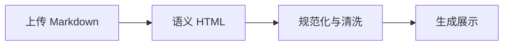

## 代码与转义

正文强调 **重点**，保留 `a < b`。

```c++
if (a < b && b > 0) {
  puts("<script>");
}
```

## 数学公式

行内 $\sqrt{x}$ 与 $\overrightarrow{AB}$。

$$
\frac{a}{b} + x^2 = y^2
$$

## 图表



## 表格和任务

| 检查项 | 结果 |
| :--- | ---: |
| HTML 语义 | 保留 |

- [x] 源码可追溯
- [ ] 等待下一批入库

<details><summary>折叠说明</summary><p>在线编辑器属于第 4 批。</p></details>
